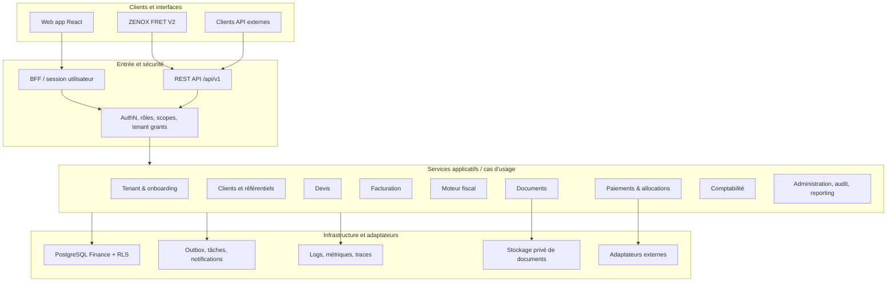

# ZENOX Finance — architecture modulaire complète

**Version :** 1.0 — architecture cible et règles de découpage  
**Date :** 2026-10-29  
**Statut :** référence d'architecture à appliquer progressivement. Ce document décrit les frontières souhaitées ; il ne prétend pas que tous les modules sont déjà implémentés.

## 1. Principes directeurs

1. ZENOX Finance est un SaaS financier autonome, multi-tenant, internationalisable et versionné. ZENOX FRET est son premier consommateur interne, pas son propriétaire.
2. Le backend Finance est la source de vérité pour les factures émises, snapshots fiscaux, numérotation, paiements enregistrés, allocations, soldes et, à terme, écritures comptables.
3. Les modules communiquent par des contrats explicites et des services applicatifs ; éviter les imports transverses de détails internes ou les écritures directes dans les tables d'un autre domaine.
4. Commencer par un **monolithe modulaire** avec frontières vérifiables. Ne pas répartir prématurément les domaines en microservices : extraire un service uniquement lorsqu'un besoin de déploiement, de sécurité, de charge ou de propriété des données le justifie.
5. Les opérations financières sont transactionnelles, idempotentes, traçables et calculées avec des types décimaux exacts. Pas de calcul monétaire avec `Number` JavaScript.
6. L'isolation tenant est imposée côté serveur et base de données. Un `tenantId` provenant d'un corps de requête n'est jamais une preuve d'autorisation.
7. Les règles fiscales, formats et packs de conformité sont versionnés, datés, sourcés et approuvés. Une règle absente, ambiguë, expirée ou non approuvée échoue de manière sûre.
8. Toute modification de contrat/API ou de schéma est accompagnée de tests, de preuves CI et d'un checkpoint.
9. Aucun module n'est déclaré « terminé » parce que ses routes ou ses écrans existent : son parcours, ses permissions, ses erreurs, ses tests et ses critères d'acceptation doivent être couverts.
10. Aucun changement de schéma ou migration vers la base Supabase distante n'est exécuté sans accord explicite.

## 2. Architecture logique



**Règle de lecture :** le schéma représente les frontières cibles, pas la preuve que tous ces composants sont déjà présents. Les adaptateurs techniques restent remplaçables ; la logique métier ne doit pas dépendre directement d'un fournisseur.

## 3. Couches et responsabilités

### 3.1 Frontend — `frontend/`

- **Application shell** : bootstrap React, routeur, layout global, navigation, erreurs de niveau application.
- **Routes** : définition des URL et composition des pages ; les composants de route délèguent aux cas d'usage de leur domaine.
- **Modules de fonctionnalité** : pages, composants, hooks, schémas de formulaire et clients API spécifiques à un domaine.
- **Composants partagés** : design system, formulaires, tableaux, états de chargement/erreur/vide, dialogue de confirmation, notifications.
- **Session et accès UI** : affichage conditionné par le rôle pour l'expérience utilisateur ; le frontend ne remplace jamais l'autorisation backend.
- **Client API typé** : gestion uniforme de base URL, session, erreurs contractuelles, corrélation et pagination.
- **Internationalisation** : chaînes traduisibles, formats de dates/nombres/devises ; aucun texte métier important ne doit être dispersé sans stratégie de traduction.
- **Tests UI** : navigation, formulaires, rôles, erreurs, responsive et accessibilité.

Le découpage actuel du routage modulaire doit servir de fondation : `main.tsx` reste minimal, `app/router` compose les routes, `app/navigation` centralise les chemins, et chaque domaine possède ses pages sans importer les détails privés d'un autre domaine.

Structure cible indicative (adapter au dépôt réel sans déplacer massivement des fichiers déjà validés) :

```text
frontend/src/
  app/                 # bootstrap, shell, router, navigation, providers
  shared/
    api/               # client HTTP et erreurs contractuelles
    auth/              # session côté UI et helpers d'accès
    components/        # composants visuels communs
    hooks/
    i18n/
    lib/
    types/
  features/
    onboarding/
    tenants/
    users-access/
    customers/
    catalog/
    currencies/
    quotes/
    invoices/
    tax/
    documents/
    payments/
    allocations/
    accounting/
    expenses/
    banking/
    customer-portal/
    notifications/
    reports/
    platform-admin/
    integrations/
    subscriptions/
    compliance/
```

Cette arborescence est une cible conceptuelle ; ne pas créer des dossiers vides pour donner l'impression qu'un module existe.

### 3.2 Backend — `backend/`

Chaque domaine backend, lorsqu'il est suffisamment développé, suit une structure cohérente :

- **routes / transport HTTP** : méthodes, chemins, validation de paramètres et traduction vers les cas d'usage ; aucune règle financière importante dans les handlers.
- **schemas / DTO** : validation stricte des entrées/sorties et contrats stables.
- **application / use-cases** : orchestration métier, transactions et permissions requises.
- **domain** : invariants, objets de valeur, états, règles et calculs purs.
- **repositories / persistence** : requêtes et mapping PostgreSQL limités au domaine propriétaire.
- **policies** : règles d'autorisation métier lorsque celles-ci ne se réduisent pas à un scope générique.
- **events / integration** : événements métier versionnés et ports vers les systèmes externes.
- **tests** : unitaires, intégration DB jetable, API, sécurité, concurrence et E2E.

Le code réel peut conserver une organisation plus légère si elle reste lisible ; les frontières et les tests sont obligatoires, pas le nombre exact de fichiers.

Structure cible indicative :

```text
backend/src/
  app/                 # composition Express, middleware et lifecycle
  api/v1/              # agrégation des routeurs versionnés
  shared/
    auth/
    config/
    db/
    errors/
    http/
    idempotency/
    observability/
    security/
    tenancy/
    validation/
  modules/
    onboarding/
    tenants/
    users-access/
    customers/
    catalog/
    currencies/
    quotes/
    invoices/
    tax/
    documents/
    payments/
    allocations/
    accounting/
    expenses/
    banking/
    customer-portal/
    notifications/
    reports/
    platform-admin/
    integrations/
    subscriptions/
    compliance/
  jobs/                # tâches fiables, retry et outbox
  test-support/
```

Si le dépôt utilise encore des dossiers `routes/`, `services/` ou `repositories/` à la racine, migrer domaine par domaine et uniquement avec tests ; ne pas imposer un grand déplacement mécanique sans bénéfice fonctionnel.

### 3.3 Base de données et migrations

- PostgreSQL Finance est distinct de la base ZENOX FRET.
- `supabase/migrations/` contient uniquement les migrations appartenant à Finance, ordonnées et immuables après application sur un environnement partagé.
- Chaque table métier doit avoir une stratégie claire de propriétaire de domaine, tenant scope, clés, contraintes, index, audit et rétention.
- RLS est une défense supplémentaire et doit être testée avec les vrais rôles runtime/grants ; elle ne remplace pas l'autorisation applicative.
- Utiliser des transactions pour les transitions financières atomiques. Les contraintes uniques et de référence doivent protéger les invariants même en cas de concurrence.
- Préférer des identifiants stables ; conserver les références externes séparées des identifiants internes.
- Les migrations sont testées sur PostgreSQL jetable, puis examinées pour compatibilité et dérive. Ne pas exécuter une migration distante sans approbation explicite.
- Pas de SQL direct de ZENOX FRET dans la base Finance.

### 3.4 Contrats et intégrations

- API REST versionnée sous `/api/v1`, contrats d'erreurs cohérents et schémas validés.
- OpenAPI doit correspondre aux routes réellement exposées ; générer ou tester les contrats lorsque possible.
- Authentification utilisateur et authentification service-à-service sont distinctes.
- Un principal d'intégration est limité par client ID, secret digesté, scopes, tenant grants, rotation/révocation et audit.
- Idempotency key, correlation ID, pagination et stratégie de retry sont définis par contrat pour les opérations concernées.
- Webhooks sortants passent par une outbox durable avec signature, livraison au moins une fois, retry borné, déduplication et visibilité d'état.
- Les adaptateurs de paiement, e-invoicing, stockage, email et autres prestataires se conforment à des interfaces internes ; les secrets ne sont jamais retournés au frontend ni écrits dans les logs.
- ZENOX FRET consomme Finance par API et n'implémente pas son propre moteur fiscal ou de numérotation Finance.

## 4. Catalogue modulaire fonctionnel

Les statuts ci-dessous sont des **domaines de construction et d'acceptation**, pas une déclaration que tout est implémenté. Le statut exact de chaque domaine doit être relié à une branche/SHA et à des tests.

| ID | Domaine | Responsabilités et résultat attendu | Dépendances principales |
|---|---|---|---|
| M01 | Identité, accès et sessions | Auth utilisateur, session BFF, rôles, permissions, invitation, activation, révocation, MFA/renforcement si retenu | Socle sécurité |
| M02 | Onboarding et tenants | Création d'espace entreprise, vérification, cycle de vie, membres initiaux et activation contrôlée | M01, audit |
| M03 | Multi-tenancy et politiques | Contexte tenant fiable, isolation, politiques, grants, tests cross-tenant | M01, M02, DB |
| M04 | Clients et contacts | CRUD, archivage, adresses, identifiants externes, validation et pagination | M02, M03 |
| M05 | Catalogue produits/services | Articles, unités, descriptions, prix de vente par défaut, statut et historique si requis | M02, M03, devis/factures |
| M06 | Devises et références | Codes de devise, précision, activation et actualisation contrôlée des références | M03 |
| M07 | Devis | Brouillon, calcul, partage, acceptation/refus, expiration, conversion contrôlée en facture | M04–M06, M08 |
| M08 | Factures et avoirs | Brouillons, lignes, révision optimiste, calcul serveur, numérotation, émission immuable, corrections/avoirs | M04, M06, M09, M10 |
| M09 | Moteur monétaire | Decimal exact, règles d'arrondi explicites, totaux reproductibles, tests de frontières | Socle transversal |
| M10 | Fiscalité | Juridictions, règles versionnées, moteur, snapshots immuables, preuve de source et fail-closed | M06, M08, M22 |
| M11 | Documents | Rendu, HTML/PDF, stockage privé, intégrité/hash, accès temporaire autorisé, rétention | M08, M10 |
| M12 | Paiements | Enregistrements, tentatives, adaptateurs de prestataires, confirmation, échec, remboursement et déduplication | M08, M09, M13 |
| M13 | Allocations et soldes | Affectation atomique de paiements, montant non affecté, solde dû, prévention de surallocation | M08, M12 |
| M14 | Comptabilité générale | Plan de comptes, journaux équilibrés, écritures immuables, périodes et clôture | M08, M10, M12, M13 |
| M15 | Dépenses et fournisseurs | Fournisseurs, factures fournisseurs, dépenses, pièces justificatives et approbations | M11, M14 |
| M16 | Banque et rapprochement | Import bancaire, transactions, correspondances, rapprochement et piste d'audit | M12–M15 |
| M17 | Portail client | Accès limité aux documents et soldes propres, acceptation de devis, téléchargements et préférences | M01, M04, M07, M08, M11 |
| M18 | Notifications | Modèles, préférences, événements, email/in-app, retries, statut et absence de fuite de données | M01, M08, M12, outbox |
| M19 | Rapports et exports | KPI calculés à partir de sources autorisées, exports paginés, filtres, traçabilité et contrôles d'accès | Domaines métiers |
| M20 | Administration plateforme | Vue tenants/utilisateurs/demandes, activation contrôlée, suspension, audit et outils de support minimaux | M01–M03, audit |
| M21 | API publique et intégrations | Applications, secrets, scopes, grants, rotation, webhooks, contrats consommateurs et intégration FRET | M01–M03, M08, M12 |
| M22 | Conformité internationale | Registre pays/autorités/sources, profils transactionnels, standards, packs versionnés et preuves d'acceptation | M10, M11, M21 |
| M23 | Plans, abonnements et quotas SaaS | Plans Finance, limites, cycle d'abonnement, usage, facturation de l'abonnement séparée des factures clients | M02, paiements si retenus |
| M24 | Audit et traçabilité | Acteur, action, cible, résultat, horodatage, correlation ID, protection des secrets et recherches contrôlées | Transversal |
| M25 | Sécurité et opérations | Secrets, config, logs/metrics/traces, alertes, sauvegarde/restauration, incident et contrôle de déploiement | Transversal |
| M26 | Internationalisation UX | Langues, formats, fuseaux horaires, accessibilité, formats monétaires et textes traduits | Frontend + domaines |
| M27 | Plateforme de tâches fiables | Outbox, tâches planifiées, retry, dead-letter/échec visible et reprise idempotente | M18, M21, M22 |
| M28 | API/contrats et compatibilité | OpenAPI, versionnement, dépréciation, erreurs, tests consommateurs et compatibilité FRET | M21, tous les domaines exposés |

Les domaines M09, M24, M25, M26, M27 et M28 sont transversaux : ils ne doivent pas être implémentés comme des silos métier indépendants.

## 5. Règles de dépendance entre modules

- Un domaine possède ses invariants et son modèle de persistance. Les autres domaines passent par ses services applicatifs ou ses contrats.
- La facturation peut lire des références client, devise et fiscalité par interfaces validées ; elle ne doit pas copier leurs règles internes.
- Une facture émise conserve les snapshots exacts de lignes, devise, arrondis, taxes, mentions et contenu de document qui ont servi à l'émission.
- Un paiement est un fait distinct d'une facture ; une allocation est un fait distinct du paiement ; une écriture comptable est un fait distinct des deux. Ne pas fusionner ces états dans un unique champ.
- Le statut « payé » est dérivé de paiements/allocation admissibles et de règles explicites ; il ne doit pas être modifié arbitrairement par le frontend.
- Les rapports consomment des vues/services autorisés ; ils ne deviennent pas une seconde source de vérité.
- L'administration plateforme peut effectuer uniquement les opérations de support explicitement autorisées et auditées ; elle ne contourne pas silencieusement l'isolation tenant.
- Les règles pays ne sont activées qu'après preuves officielles, tests, date d'effet et revue exigée pour le périmètre déclaré.

## 6. Sécurité et invariants non négociables

1. Toute lecture/écriture tenant est autorisée à partir d'une identité authentifiée et d'un membership/grant actif.
2. Tests négatifs cross-tenant pour API, documents, exports, portail, jobs et intégrations.
3. Runtime DB au moindre privilège, sans superuser ni BYPASSRLS en usage applicatif normal.
4. Secrets stockés sous forme adaptée (digest/secret manager selon leur usage), rotation et révocation prévues.
5. Pas de secrets, données de paiement sensibles ou données client inutiles dans les logs.
6. Toute mutation sensible et financière est auditée avec attribution d'acteur.
7. Toute commande financière répétable dispose d'une stratégie d'idempotence ; les collisions de payload sont rejetées.
8. Transactions et contraintes empêchent numérotation en double, surallocation et doubles effets concurrents.
9. Les documents et snapshots émis sont immuables pour les rôles ordinaires ; les corrections sont des opérations explicites.
10. Les règles fiscales non prouvées ou périmées bloquent les opérations concernées au lieu d'être remplacées par une valeur supposée.

## 7. Architecture de tests et critères de complétude

Chaque module est livré avec une fiche d'acceptation et des preuves associées au SHA testé.

- **Unitaires** : règles pures, transitions, Decimal, validations et erreurs.
- **Intégration DB jetable** : migrations, contraintes, transactions, RLS, grants et isolation.
- **API** : auth, permissions, validation, pagination, idempotence, erreurs et compatibilité.
- **Concurrence** : numérotation, émission, allocations, callbacks et retries simultanés.
- **E2E métier** : parcours de bout en bout avec données de test non réelles.
- **Frontend** : navigation, rôles, états d'erreur/chargement/vide, accessibilité et responsive.
- **Contrats** : OpenAPI et tests consommateurs, en particulier ZENOX FRET.
- **Opérations** : dérive de migration, observabilité et restauration lorsque le périmètre le requiert.

Un module est considéré **complet pour une version donnée** seulement si : exigences définies, parcours nominal et erreurs couverts, permissions testées, isolation tenant prouvée, migrations compatibles et testées sur DB jetable, tests CI verts sur le SHA exact, UI et API cohérentes, documentation mise à jour, aucun risque bloquant non accepté, et checkpoint enregistré. Une CI verte est nécessaire mais ne prouve pas à elle seule la conformité réglementaire ou la préparation production.

## 8. Stratégie de livraison

1. Conserver un monolithe modulaire ; figer les contrats avant de multiplier les consommateurs.
2. Travailler domaine par domaine, en terminant et validant le module avant de passer au suivant, sauf dépendance bloquante documentée.
3. Priorité fonctionnelle suggérée : stabilisation routage/API → onboarding et accès → clients/devise/catalogue → clôture factures/avoirs/documents → devis → paiements → allocations/solde → intégration FRET → conformité par juridiction → rapports/portail/notifications → comptabilité, dépenses et rapprochement → abonnements et production.
4. Chaque tranche doit être développée sur une branche GitHub dédiée, avec tests CI et checkpoint ; ne pas fusionner une PR sans accord explicite.
5. Après validation GitHub, intégrer prudemment dans le dossier local réel existant en préservant les modifications de travail. Ne pas créer de dossier local de test séparé comme voie par défaut.
6. Utiliser une base PostgreSQL jetable pour les tests d'intégration. Toute migration distante reste bloquée jusqu'à approbation explicite.
7. Ne pas annoncer de pourcentage de couverture internationale avant approbation du catalogue et des pondérations, et ne pas annoncer la conformité d'une juridiction sans preuves adaptées.

## 9. Décisions qui restent à confirmer

- Juridictions et profils transactionnels du premier lancement.
- Prestataires de paiement et disponibilité/conditions par pays.
- Choix de stockage privé, génération PDF et conservation.
- Portée de la comptabilité générale dans le MVP initial.
- Politique d'abonnement/quotas et séparation avec les factures émises aux clients.
- RPO/RTO, objectifs de performance, rétention et plan de reprise.
- Processus de validation juridique locale et d'homologation/partenariat pour l'e-invoicing.
- Pondérations et catalogue approuvés de la mesure de couverture.

Tant que ces décisions ne sont pas documentées et acceptées, les modules concernés restent « conception/validation en cours » ; l'architecture n'autorise pas à les déclarer déjà livrés.
